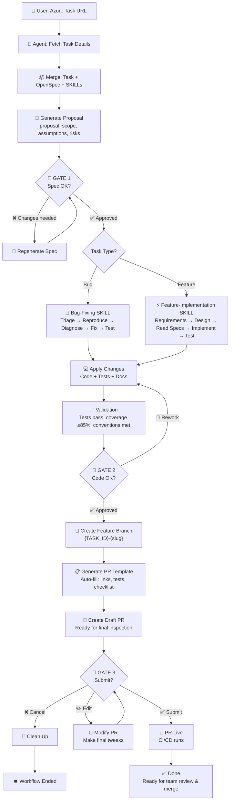

# Development Workflow: Bug Fixing, Feature Implementation & Orchestration

**End-to-end systematic workflow** combining **bug-fixing** + **feature-implementation** + **Azure DevOps→Gitea orchestration** with **3 human approval gates**, **automatic SKILL selection**, and **quality gate enforcement**.

---

## 📋 Overview

| Phase | Actor | Input | Output | Gate |
|-------|-------|-------|--------|------|
| **Triage** | Agent | Azure Task URL | Task metadata + Spec proposal | ✋ Review |
| **Spec Approval** | Human | Proposal | ✅ Approved spec | **GATE 1** |
| **Implement** | Agent/SKILL | Approved spec | Code changes + tests | - |
| **Code Review** | Human | Implementation | ✅ Approved code | **GATE 2** |
| **PR Creation** | Agent | Reviewed code | Draft Gitea PR | - |
| **Submission** | Human | Draft PR | ✅ Live PR | **GATE 3** |

---

## 🎯 When to Use

✅ **Use this workflow when:**
- Starting work on an Azure DevOps task (bug, feature, docs)
- Working in a structured team environment with formal approval gates
- Building components requiring spec compliance and audit trail
- Multiple developers contributing to same codebase
- Need systematic approach with quality gate enforcement

❌ **Don't use when:**
- Quick hotfixes with no review needed
- Personal exploration/experimentation only
- Already in an approved PR (use that flow instead)

---

## 🔧 Prerequisites

**Before starting:**

1. ✅ **Azure DevOps access**
   - Active task URL (e.g., `https://dev.azure.com/{org}/{project}/_workitems/edit/{id}`)
   - Read permissions on task details

2. ✅ **Gitea access**
   - Personal access token for creating branches/PRs
   - Write permissions on target repo

3. ✅ **Local setup**
   - Git configured with push access
   - Latest code synced from `development` branch
   - SKILL dependencies available (depends on task type)

4. ✅ **OpenSpec** (recommended)
   - Understand baseline project structure
   - Review relevant specs for your change type

---

## 📍 Complete Step-by-Step Flow

### 🔍 **Step 1-3: Triage & Spec Generation**

```
[Azure Task URL]
    ↓
[Agent: Fetch Task Details]
    ├─ Task ID, title, description
    ├─ Acceptance criteria
    └─ Priority / tags
    ↓
[Agent: Merge with OpenSpec]
    ├─ Identify concern area (UI/API/Security/Test/Docs)
    ├─ Select applicable SKILL(s)
    └─ Determine bug-fixing vs feature-implementation path
    ↓
[Generate OpenSpec Proposal]
    ├─ proposal.md (high-level summary + solution)
    ├─ scope.md (files, modules, affected areas)
    ├─ assumptions.md (design assumptions, dependencies)
    ├─ risks.md (rollback plan, migration steps)
    ├─ test-impact.md (test strategy, coverage targets)
    └─ compliance.md (security, a11y, performance gates)
```

---

### ✋ **GATE 1: Spec Approval** (Human decision point)

```
[OpenSpec Proposal Generated]
    ↓
👤 HUMAN SPEC REVIEW
    ├─ Problem statement matches task?
    ├─ Proposed solution is sound?
    ├─ Files/modules impacted are correct?
    ├─ Test strategy covers acceptance criteria?
    ├─ Rollback plan is clear?
    └─ No conflicting changes?
    ↓
Decision:
    ├─ ✅ Spec looks good → Continue to implementation
    ├─ ✏️  Changes needed → Regenerate & re-review
    └─ ❌ Not proceeding → Stop workflow
```

**What human reviews:**
- ✅ Problem statement matches task
- ✅ Proposed solution is sound
- ✅ Files/modules impacted are correct
- ✅ Test strategy covers acceptance criteria
- ✅ Rollback plan is clear
- ✅ No conflicting changes

---

### 🛠 **Step 4-6: Implementation Phase**

**Workflow Path A: Bug Fixing** (If task is bug/fix/regression)

```
[Spec Approved - Bug Fix]
    ↓
[Agent: Enable bug-fixing SKILL]
    ├─ Triage: Classify bug type, severity
    ├─ Reproduce: Confirm bug, create minimal test case
    ├─ Diagnose: Find root cause, analyze code path
    ├─ Fix: Implement minimal fix (no scope creep)
    ├─ Test: Add regression test, validate no side effects
    └─ Document: Update CHANGELOG.md
    ↓
[Apply Changes Incrementally]
    ├─ Code changes committed
    ├─ Tests written (≥85% coverage)
    ├─ CHANGELOG updated
    └─ Tracked incrementally
```

**Common Bug Patterns:**
- Parameter validation → Validate in `OnParametersSetAsync`
- ConfigureAwait missing → Add `.ConfigureAwait(true)` to all awaits
- AI inference parsing → Fix regex patterns, test multiline
- XSS security → Replace `AddMarkupContent` with `AddContent`
- DI registration → Verify `AddSmartComponents()` call

---

**Workflow Path B: Feature Implementation** (If task is feature/enhancement/new-parameter)

```
[Spec Approved - Feature]
    ↓
[Agent: Enable feature-implementation SKILL]
    ├─ Requirements: Define success criteria
    ├─ Design: Design public API, plan implementation
    ├─ Read Specs: Read all applicable foundation specs
    ├─ Implement: Write code following conventions
    ├─ Test: Write comprehensive tests (≥85% coverage)
    ├─ Document: Add examples, update README/CHANGELOG
    └─ Review: Self-validate all quality gates
    ↓
[Apply Changes Incrementally]
    ├─ Code changes committed
    ├─ Tests written (≥85% coverage)
    ├─ Documentation updated
    └─ Tracked incrementally
```

**Feature Type Coverage:**
- ✅ Add component parameter (`[Parameter]`)
- ✅ Add event callback (`EventCallback<T>`)
- ✅ Add public method
- ✅ Enhance AI inference capabilities
- ✅ Add configuration options
- ✅ Performance improvements
- ✅ Accessibility enhancements

---

### 👀 **GATE 2: Code Review** (Human decision point)

```
[Implementation Complete]
    ↓
[Agent: Generate Review Summary]
    ├─ Files changed with diff
    ├─ Lines added/removed
    ├─ Test results (pass/fail, coverage delta)
    ├─ Compliance checks (naming, conventions, coverage)
    └─ Quality metrics
    ↓
👤 HUMAN CODE REVIEW
    ├─ Code quality & style acceptable?
    ├─ Test coverage sufficient (≥85%)?
    ├─ Security concerns addressed?
    ├─ Performance acceptable?
    ├─ Documentation clear?
    └─ No merge conflicts expected?
    ↓
Decision:
    ├─ ✅ LGTM → Proceed to branch creation
    ├─ 🔧 Rework needed → Back to implementation
    └─ ❌ Not proceeding → Stop & clean up
```

**Human checks:**
- ✅ Code quality & style
- ✅ Test coverage sufficient (≥85% lines, ≥80% branches)
- ✅ Security concerns addressed
- ✅ Performance acceptable
- ✅ Documentation clear
- ✅ No merge conflicts expected

---

### 🌱 **Step 7-8: Branch & PR Setup**

```
[Code Approved]
    ↓
[Create Feature Branch]
    ├─ Name: feature/{TASK_ID}-{type}-{slug}
    ├─ Source: development
    ├─ Pushed to origin
    └─ Example: feature/BUG-12345-fix-multiline-parsing
    ↓
[Generate PR Template]
    ├─ Title: [{TASK_ID}] {short summary}
    ├─ Description: Auto-filled with links, tests, AC
    ├─ Checklist: Auto-filled from spec
    ├─ Reviewers: Auto-assigned
    ├─ Labels: Auto-assigned from task type
    └─ Linked Specs: References from proposal
    ↓
[Create Draft PR in Gitea]
    ├─ PR visible but not in merge queue
    ├─ All auto-populated fields ready
    └─ Awaiting final human approval
```

**PR Contents Auto-Populated:**
- ✅ Task reference link
- ✅ Test execution summary
- ✅ Linked spec sections
- ✅ Acceptance criteria checklist
- ✅ CI/CD gates status
- ✅ Deployment notes (if applicable)

---

### ✋ **GATE 3: PR Submission** (Human final approval)

```
[Draft PR Created]
    ↓
👤 HUMAN FINAL REVIEW
    ├─ Title and description correct?
    ├─ Checklist items accurate?
    ├─ Linked specs correct?
    ├─ All fields populated?
    └─ Ready to go live?
    ↓
Decision:
    ├─ ✅ All looks good → Submit PR to team
    ├─ ✏️  Final tweaks → Edit PR in UI, re-submit
    └─ ❌ Cancel → Clean up branch, end workflow
```

**PR Submission Options:**
- ✅ Submit PR (goes live, CI/CD runs)
- ✏️ Edit draft (make final tweaks in UI)
- ❌ Cancel (delete branch, end workflow)

---

### ✅ **Step 9: Done - Ready for Team**

```
[PR Submitted]
    ↓
[CI/CD Pipeline Runs]
    ├─ Build all TFMs (net8.0, net9.0, net10.0)
    ├─ Run all tests
    ├─ Coverage check (≥85% lines, ≥80% branches)
    ├─ ESLint/dotnet format validation
    ├─ Security scan (gitleaks, a11y scan)
    └─ Update Azure Task (optional)
    ↓
[Ready for Team Review & Merge]
```

**Optional Automation:**
- Auto-update Azure Task state to "In Review"
- Add PR link to task
- Send Slack notification
- Auto-assign reviewers

---

## 🔄 Complete Mermaid Flowchart



---

## 🛠 Complete Implementation Checklist

### **Pre-Flight Checks**
- [ ] Azure Task URL accessible
- [ ] Gitea personal token configured
- [ ] `development` branch synced locally
- [ ] No uncommitted changes in working tree
- [ ] Read access to relevant specs

### **Phase 1: Triage & Proposal** (Agent)
- [ ] Fetch task ID, title, description, AC
- [ ] Identify task type (bug vs feature)
- [ ] Identify concern area (UI/API/Security/Test/Docs)
- [ ] Select applicable SKILL(s)
- [ ] Generate all proposal files (6 docs)
- [ ] Verify task ↔ proposal alignment

### **Phase 2: Spec Review** (Human - **GATE 1**)
- [ ] Read proposal.md completely
- [ ] Verify scope matches task exactly
- [ ] Check assumptions & risks alignment
- [ ] Verify test strategy adequacy
- [ ] **Decision: ✅ Approve / ✏️ Revise / ❌ Reject**

### **Phase 3: Implementation** (Agent/SKILL)

**For Bug Fixes:**
- [ ] Triage: Classify bug type, severity
- [ ] Reproduce: Create minimal test case
- [ ] Diagnose: Identify root cause
- [ ] Implement: Minimal fix (no scope creep)
- [ ] Write regression test
- [ ] Verify no side effects

**For Features:**
- [ ] Read ALL applicable specs (foundation + component)
- [ ] Design public API carefully
- [ ] Implement per spec patterns exactly
- [ ] Write comprehensive test scenarios
- [ ] Update README/demo with example

**Both Paths:**
- [ ] Apply changes incrementally
- [ ] Write tests (≥85% coverage)
- [ ] Run tests locally (100% pass)
- [ ] Update CHANGELOG.md
- [ ] Follow code conventions (ConfigureAwait, nullable, Constants.cs)
- [ ] Commit with message: `[{TASK_ID}] {description}`

### **Phase 4: Code Review** (Human - **GATE 2**)
- [ ] Review file diffs carefully
- [ ] Verify test coverage (≥85% lines, ≥80% branches)
- [ ] Check for security issues
- [ ] Verify conventions followed
- [ ] Confirm no merge conflicts expected
- [ ] **Decision: ✅ Approve / 🔧 Rework / ❌ Reject**

### **Phase 5: Branch & PR Creation** (Agent)
- [ ] Create feature branch from `development`
- [ ] Branch name: `feature/{TASK_ID}-{slug}`
- [ ] Push to origin
- [ ] Generate PR template (auto-filled)
- [ ] Fill all checklist items
- [ ] Link to Azure Task
- [ ] Create draft PR in Gitea
- [ ] Verify all fields populated

### **Phase 6: PR Submission** (Human - **GATE 3**)
- [ ] Review draft PR completely
- [ ] Title and description correct?
- [ ] Checklist items accurate?
- [ ] Linked specs correct?
- [ ] All auto-populated fields verified?
- [ ] **Decision: ✅ Submit / ✏️ Edit / ❌ Cancel**

### **Phase 7: CI/CD & Done** (Automatic)
- [ ] PR goes live in Gitea
- [ ] CI/CD pipeline runs automatically
- [ ] All checks pass ✅
- [ ] Ready for team review & merge

---

## 📊 Key Decision Gates

| Gate | Phase | Approver | Decision | If Approved | If Rejected |
|------|-------|----------|----------|------------|------------|
| **GATE 1** | Spec Review | Human | Spec OK? | → Implement | → Regen spec / Stop |
| **GATE 2** | Code Review | Human | Quality OK? | → Create PR | → Rework / Stop |
| **GATE 3** | PR Submit | Human | Ready? | → Submit PR | → Edit / Cancel |

---

## 🎓 Example Workflows

### Example 1: Bug Fix (SmartTextArea multiline parsing)

**Trigger:**
```
Human: "Fix this bug: https://dev.azure.com/org/proj/_workitems/edit/12345"
```

**Phase 1: Triage & Proposal**
```
Agent identifies:
- Type: Bug (fix)
- Task: "SmartTextArea: Fix OK:[...] response parsing"
- Issue: "Multiline suggestions not parsed correctly"
- AC: "Parse OK:[multiline content]END_INSERTION format"
- SKILL: csharp-dotnet (parsing logic)
- Files: SmartTextAreaInference.cs, SmartTextAreaInferenceTests.cs

Generates proposal:
- proposal.md: Multiline parsing issue root cause
- scope.md: 2 files, ~50 LOC changes
- assumptions.md: Regex pattern fix sufficient
- risks.md: Rollback: revert commits
- test-impact.md: 4 test scenarios (multiline, empty, special chars)
```

**Phase 2: Spec Review (GATE 1)**
```
Human reviews:
✅ "Looks good, multiline parsing is the real issue"
✅ "Test strategy covers edge cases"
✅ "Rollback plan clear"

Decision: ✅ APPROVED → Proceed
```

**Phase 3: Implementation**
```
Agent (csharp-dotnet SKILL):
1. Diagnose: Regex pattern doesn't handle \n correctly
2. Fix: s/OK:\[(.*?)\]END_INSERTION/OK:[\1]END_INSERTION/s
3. Add tests:
   - Multiline content
   - Empty content
   - Special characters
   - Unicode content
4. Run: dotnet test → 100% pass ✅
5. Coverage: 87% ✅
6. Commit: [BUG-12345] Fix multiline suggestion parsing
```

**Phase 4: Code Review (GATE 2)**
```
Human reviews diff:
✅ "Regex fix solid, handles multiline correctly"
✅ "Tests comprehensive (4 scenarios)"
✅ "Coverage 87% > 85% threshold"
✅ "No breaking changes"

Decision: ✅ APPROVED → Create PR
```

**Phase 5: PR Creation**
```
Agent creates:
- Branch: feature/BUG-12345-fix-multiline-parsing
- PR Title: [BUG-12345] Fix SmartTextArea multiline suggestion parsing
- PR Description: Auto-filled with:
  - Task link
  - Changes summary
  - Test results (4/4 pass)
  - Coverage delta (80% → 87%)
  - Linked specs
```

**Phase 6: PR Submission (GATE 3)**
```
Human final review:
✅ "All looks good!"

Decision: ✅ SUBMIT

PR goes live → CI/CD runs → Ready for team merge
```

---

### Example 2: Feature Implementation (Add MaxSuggestions parameter)

**Trigger:**
```
Human: "Add MaxSuggestions parameter to limit AI suggestions"
```

**Phase 1: Triage & Proposal**
```
Agent identifies:
- Type: Feature (enhancement)
- Task: "SmartTextArea: Add MaxSuggestions parameter"
- Requirements: int param, range 1-10, default 5
- SKILL: feature-implementation, razor-components-design, testing
- Files: SfSmartTextArea.cs, SmartTextAreaSettings.cs, SmartTextAreaInference.cs, tests

Generates proposal:
- proposal.md: New parameter to limit suggestions
- scope.md: 5 files, ~100 LOC changes
- assumptions.md: Inference middleware already handles batch limiting
- risks.md: Rollback: remove parameter, default behavior
- test-impact.md: 7 test scenarios (boundary, validation, etc.)
- compliance.md: WCAG a11y check, security validation
```

**Phase 2: Spec Review (GATE 1)**
```
Human reviews:
✅ "Looks good, parameter design sound"
✅ "Test strategy thorough (7 scenarios)"
✅ "Compliance gates clear"

Decision: ✅ APPROVED → Proceed
```

**Phase 3: Implementation**
```
Agent (feature-implementation SKILL):
1. Read specs:
   - blazor-lifecycle-aiservice (parameter binding)
   - razor-components-design ([Parameter] pattern)
   - testing-standards (coverage targets)
   - smart-textarea/spec.md (component specifics)

2. Design:
   - [Parameter] public int MaxSuggestions { get; set; } = 5
   - Validation in OnParametersSetAsync: range 1-10
   - Pass to SmartTextAreaInference

3. Implement:
   - Add parameter + constant
   - Add validation + exception
   - Update inference middleware
   - Add to settings class

4. Test (7 scenarios):
   - Valid boundary values (1, 5, 10)
   - Invalid values (0, 11, -1) → exception
   - Default value (5)
   - Runtime change handling

5. Coverage: 100% ✅
6. Documentation:
   - Add README example
   - Update demo app
   - CHANGELOG entry
```

**Phase 4: Code Review (GATE 2)**
```
Human reviews:
✅ "Parameter design follows conventions"
✅ "Validation thorough (1-10 range)"
✅ "Tests comprehensive (7 scenarios)"
✅ "100% coverage achieved"
✅ "Documentation complete"

Decision: ✅ APPROVED → Create PR
```

**Phase 5: PR Creation**
```
Agent creates:
- Branch: feature/OPSX-12346-add-max-suggestions
- PR Title: [OPSX-12346] Add MaxSuggestions parameter to SmartTextArea
- PR Description: Auto-filled with:
  - Feature summary
  - API changes
  - 7 test results
  - 100% coverage
  - Linked specs (4)
```

**Phase 6: PR Submission (GATE 3)**
```
Human final review:
✅ "Ready to go!"

Decision: ✅ SUBMIT

PR goes live → CI/CD runs → Ready for team merge
```

---

## 🔌 SKILL Integration & Auto-Selection

| Scenario | Task Type | Primary SKILL | Secondary SKILLs | Auto-Enable |
|----------|-----------|-----------------|------------------|------------|
| **Bug: Lifecycle** | bug | bug-fixing | blazor-lifecycle, testing | Yes |
| **Bug: Security** | bug | bug-fixing | dotnet-security, testing | Yes |
| **Bug: Parsing** | bug | bug-fixing | csharp-dotnet, testing | Yes |
| **Feature: UI** | feature | feature-implementation | razor-components-design, testing, a11y | Yes |
| **Feature: API** | feature | feature-implementation | csharp-dotnet, testing | Yes |
| **Feature: Inference** | feature | feature-implementation | csharp-dotnet, testing | Yes |

---

## 📝 OpenSpec Artifacts Generated

**Directory structure created for each task:**

```
openspec/
└── changes/
    └── {AZURE_TASK_ID}/
        ├── proposal.md          ← High-level summary + solution
        ├── scope.md             ← Files, modules, affected areas
        ├── assumptions.md       ← Design assumptions, dependencies
        ├── risks.md             ← Rollback plan, migration steps
        ├── test-impact.md       ← Test strategy, coverage targets
        ├── compliance.md        ← Security, a11y, performance gates
        └── tasks/               ← Subtasks (optional)
            ├── task-1.md
            ├── task-2.md
            └── task-3.md
```

---

## 🚨 Troubleshooting

### Issue: "Spec generation hangs"
**Solution:** Reduce task scope, break into subtasks, check network connectivity

### Issue: "Code review takes too long"
**Solution:** Pre-review with SKILL analysis + clear summary → faster approval

### Issue: "PR has merge conflicts"
**Solution:** Sync `development` before implementing, resolve and recommit

### Issue: "Tests fail in CI but pass locally"
**Solution:** TFM mismatch. Run `dotnet test -f all` locally to test all frameworks

### Issue: "Coverage below threshold"
**Solution:** Add missing test cases, run `dotnet test /p:CollectCoverage=true`

### Issue: "Human wants spec changes mid-implementation"
**Solution:** Stop implementation, regenerate spec with changes, restart approval

---

## 🎯 Success Criteria

✅ **Workflow succeeds when:**
- [ ] GATE 1: Human approved spec
- [ ] GATE 2: Human approved code
- [ ] GATE 3: Human approved PR
- [ ] All CI/CD gates pass
- [ ] PR merged without conflicts
- [ ] Azure Task auto-linked in PR
- [ ] Coverage maintained (≥85% lines)
- [ ] Tests all pass (100% on new code)
- [ ] Documentation updated

---

## 📚 Related Skills & Resources

| Skill | File | When |
|-------|------|------|
| **bug-fixing** | `.github/skills/bug-fixing/SKILL.md` | Detailed bug workflow |
| **feature-implementation** | `.github/skills/feature-implementation/SKILL.md` | Detailed feature workflow |
| **testing** | `.github/skills/testing/SKILL.md` | Coverage & test standards |
| **blazor-lifecycle** | `.github/skills/blazor-lifecycle/SKILL.md` | Component lifecycle |
| **dotnet-security** | `.github/skills/dotnet-security/SKILL.md` | Security validation |
| **openspec-apply-change** | `.github/skills/openspec-apply-change/SKILL.md` | Spec implementation details |

---

## 🔗 Quick Links

| Resource | Purpose |
|----------|---------|
| `openspec/spec-selector.md` | Which specs to read for your change |
| `openspec/project.md` | Architecture & file structure |
| `.github/skills/README.md` | All skills directory |
| `openspec/specs/README.md` | All specs directory |

---

## 💡 Pro Tips

1. **Batch related changes** → One task = one proposal = one PR (fewer approval cycles)
2. **Read ALL applicable specs** before implementing (prevents rework)
3. **Pre-check coverage** before code review (ensure ≥85%)
4. **Link early** → Reference task in commit messages for traceability
5. **Template consistency** → Use same PR format for all tasks (maintainability)
6. **Gate discipline** → Don't skip approval gates (quality depends on it)
7. **Incremental commits** → Small, logical commits (easier to review)

---

## ✅ First-Time Checklist

- [ ] Read this entire SKILL (understand all 3 gates)
- [ ] Find sample Azure Task URL
- [ ] Understand task type (bug vs feature)
- [ ] Run triage agent on task
- [ ] Review generated proposal (6 docs)
- [ ] Request/give spec approval (GATE 1)
- [ ] Implement per approved spec
- [ ] Request/give code review (GATE 2)
- [ ] Review draft PR
- [ ] Approve/submit PR (GATE 3)
- [ ] Monitor CI/CD pipeline
- [ ] Task complete ✅

---

## 📊 Key Metrics Tracked

**Per task (in openspec/changes/{ID}/):**
- ✅ Spec review time
- ✅ Implementation time
- ✅ Code review time
- ✅ Test coverage (%)
- ✅ Test pass rate (%)
- ✅ Breaking changes (count)
- ✅ PR approval time

---

## Version History

| Version | Date | Changes |
|---------|------|---------|
| **2.0** | 2026-03-30 | Merged bug-fixing + feature-implementation + orchestration into single unified workflow |
| **1.0** | 2026-03-25 | Initial: Separated skills integration tracking |

